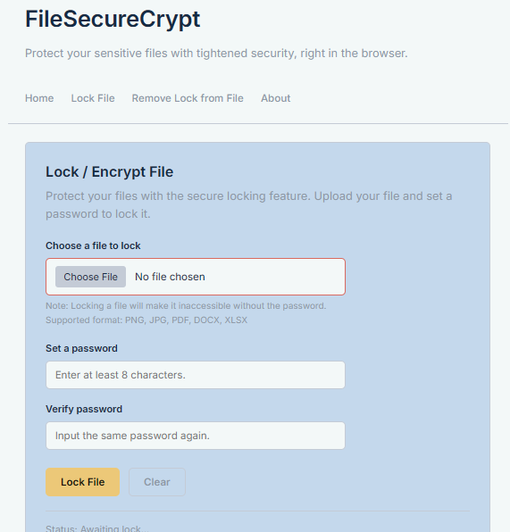
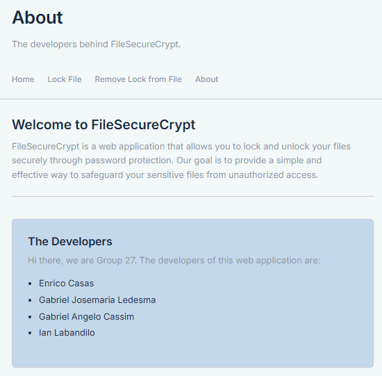

# FileSecureCrypt
A browser-based application that lets users have the ability to secure their images or documents with a file lock encryption feature. 

| Subject | Section | Group Number | Members: |
| :-----: | :-----: | :-----: | :-------------: |
| MO-IT120: Web Systems and Technology    Mentor: Mr. Aldrin John Tamayo | H3101 | Group 27 | Enrico Casas   Gabriel Josemaria Ledesma   Gabriel Angelo Cassim   Ian Labandilo | 

### Homepage

### About
