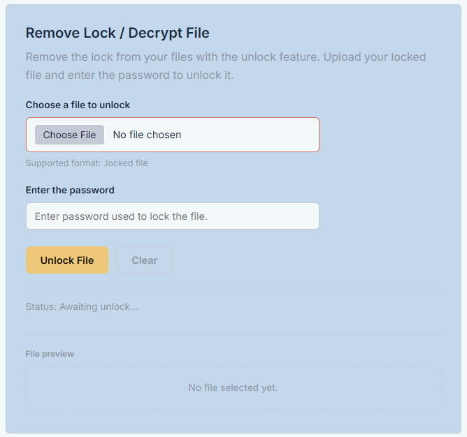
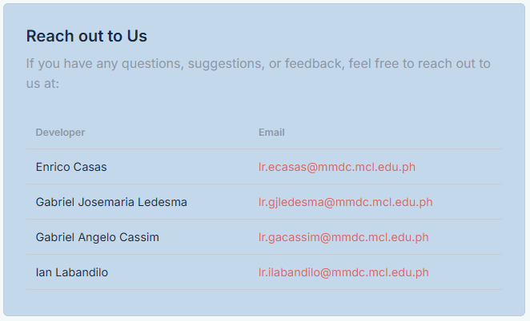

# FileSecureCrypt
A browser-based application that lets users have the ability to secure their images or documents with a file lock encryption feature. 

| Subject | Section | Course Mentor | Group Number | Members: |
| :-----: | :-----: | :----: | :----------: | :------: |
| MO-IT120: Web Systems and Technology    | H3101  | Mr. Aldrin John Tamayo | Group 27 | Enrico Casas    Gabriel Josemaria Ledesma    Gabriel Angelo Cassim    Ian Labandilo | 

### All Sections
| Section | Screenshot | Description |  
| :-----: | :--------: | :---------: |
| Lock / Encrypt File |  | This feature enables a user to lock their site-compatible desired file with a password. Once converted, a .locked file will automatically download and be saved to the user's computer. |
| Remove Lock / Decrypt File |  | This feature lets the user unlock a .locked file by entering the password the user used to lock the specific file in the first place. Once unlocked, an unencrypted file will automically download and be saved to the user's computer. |
| About |     | This section of the web application has the list of the developers and their contact details. |