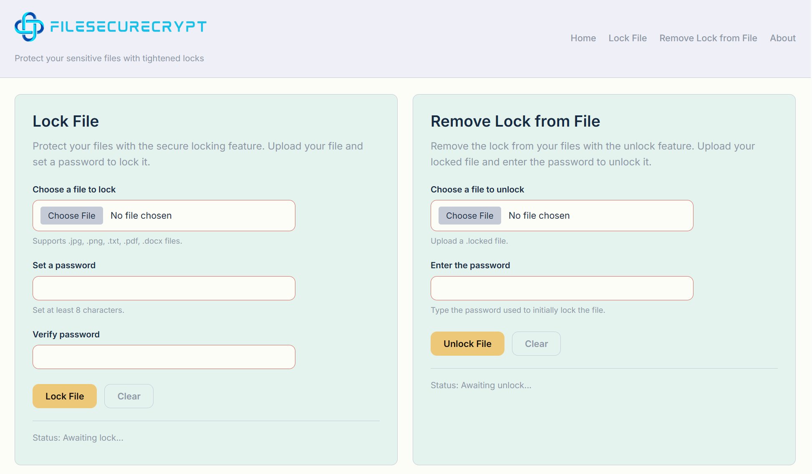
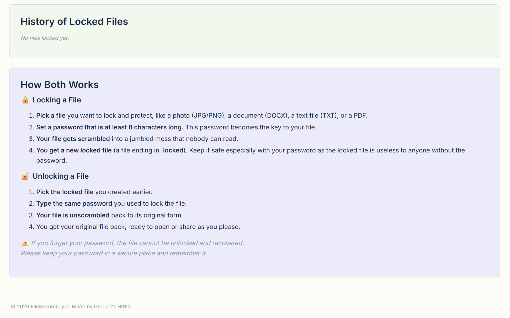

# 

A browser-based application that lets users have the ability to secure their images or documents with a file lock encryption feature. 

| Subject | Section | Course Mentor | Group Number | Group Members |
| :-----: | :-----: | :----: | :----------: | :------: |
| MO-IT120: Web Systems and Technology | H3101  | Mr. Aldrin John Tamayo | Group 27 | Enrico Casas    Gabriel Josemaria Ledesma    Gabriel Angelo Cassim | 

## Sections
| Feature / Section | Image | Description |
| :------: | :---: | :---------: |
| Lock File + Remove Lock from File |  | <b><u>Lock File</u></b>   This feature enables a user to lock their site-compatible desired file with a password. Once converted, a .locked file will automatically download and be saved to the user's computer.    <b><u>Remove Lock from File</u></b>   This feature lets the user unlock a .locked file by entering the password the user used to lock the specific file in the first place. Once unlocked, an unencrypted file will automically download and be saved to the user's computer. |
| History of Locally Locked Files + Guide    |  | <b><u>History of Locally Locked Files</u></b>   This section shows the local list of what files the user has locked so far. This is automatically updated once a file has been locked successfully.    <b><u>Guide</u></b>   Shows how each feature works and guides what the user must do.|
| About |  | This section has the list of the developers and their contact details. |